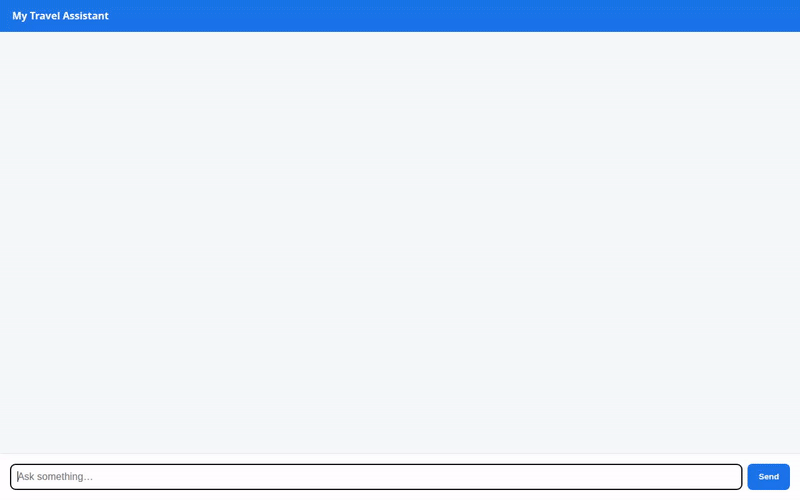

# My Travel Assistant 🌍✈️

An intelligent, memory-enabled AI travel concierge built with the **Agent Development Kit (ADK)** and powered by **Gemini 2.5 Flash**. My Travel Assistant remembers user preferences across sessions, plans multi-stop travel itineraries with interactive Google Maps routing, queries destination databases, generates scenic destination concept art, and renders dynamic Agent-to-User Interface (A2UI) cards.



---

## 🌟 Key Features & Capabilities

* **🧠 Long-Term Memory Bank**: Remembers user preferences, dietary restrictions, budget styles, and personal background across conversations using **Vertex AI Memory Bank Service**.
* **🗺️ Multi-Stop Itinerary & Route Planning**: Calculates leg-by-leg routing, travel times, and distances using the **Google Routes API**, generating clickable Google Maps directions links.
* **📍 Geocoding & Places Discovery**: Converts place names and landmarks into geographical coordinates (**Google Geocoding API**) and finds nearby attractions, hotels, and dining spots (**Google Places API New**).
* **🗄️ Destination Database**: Streamlined search and destination management stored in **Google Cloud Firestore**.
* **🎨 AI Image Generation & Cloud Storage**: Generates scenic destination concept art using **Gemini 3.1 Flash Lite Image** (`gemini-3.1-flash-lite-image`) and publishes public images directly to **Google Cloud Storage**.
* **💱 Live Currency Exchange & Web Grounding**: Real-time currency conversion using the **Frankfurter API** and up-to-date live web search grounding with **Google Search**.
* **🧮 Secure Python Code Execution**: Runs budget calculations and math analysis safely inside the **Agent Engine Sandbox Code Executor**.
* **🎨 Structured A2UI Components**: Delivers rich, structured UI cards rendered via **A2UI 0.8 Schema Manager** and the **Basic Catalog**.

---

## 🛠️ Tech Stack & Google Cloud Services

* **Core Framework**: Python 3.14, Agent Development Kit (ADK)
* **LLM**: Gemini 2.5 Flash (`gemini-2.5-flash`)
* **Image Model**: Gemini 3.1 Flash Lite Image (`gemini-3.1-flash-lite-image`)
* **Google Cloud Infrastructure**:
  * **Vertex AI Memory Bank**: Long-term session memory persistence
  * **Google Cloud Firestore**: NoSQL document storage for travel destinations
  * **Google Cloud Storage**: Public media bucket for generated destination images
  * **Agent Engine Sandbox**: Isolated Python code execution sandbox
  * **Agent Engine / Agent Runtime**: Deployed backend reasoning engine
* **APIs & Grounding**:
  * **Google Routes API** (`computeRoutes`)
  * **Google Geocoding API**
  * **Google Places API (New)** (`searchNearby`)
  * **Google Search** (Live web grounding)
  * **Frankfurter API** (Live currency exchange rates)

---

## 📁 Repository Structure

```
.
├── app/
│   ├── agent.py          # Main ADK Agent definition, tools, memory callback & A2UI setup
│   ├── a2ui_utils.py     # A2UI response formatting callback
│   └── GEMINI.md         # Agent system prompt and operational guidelines
├── frontend/
│   ├── main.py           # FastAPI proxy connecting browser UI to Agent Engine via A2A
│   ├── requirements.txt # Dependencies for the frontend proxy
│   └── static/
│       └── index.html    # Plain chat UI with built-in A2UI mini-renderer
├── agents-cli-manifest.yaml # Deployment manifest configuration
├── demo.gif              # Animated demo recording of the assistant in action
└── README.md             # Project documentation
```

---

## 🚀 Local Setup & Running Instructions

### Prerequisites
* Python 3.10+
* `uv` or `pip` package manager
* Google Cloud project with Vertex AI, Firestore, Cloud Storage, and Maps APIs enabled
* Google Maps API Key (`GOOGLE_MAPS_API_KEY`)

### 1. Environment Setup

Clone the repository and set up environment variables:

```bash
# Export required environment variables
export GOOGLE_MAPS_API_KEY=your_api_key_here
export GOOGLE_CLOUD_PROJECT=your_project_id_here
```

Install backend dependencies:

```bash
uv pip install -r requirements.txt
```

### 2. Running the Agent Backend

Start the ADK development server locally:

```bash
agents-cli run --mode dev
```

### 3. Running the Frontend Proxy & Chat UI

In a separate terminal, navigate to the `frontend/` directory, install dependencies, and launch the FastAPI server:

```bash
cd frontend
pip install -r requirements.txt

# Set local or remote agent environment targets
export AGENT_ENGINE_RESOURCE_NAME="projects/YOUR_PROJECT/locations/us-east1/reasoningEngines/YOUR_ENGINE_ID"
export AGENT_DIRECTORY="app"

python main.py
```

Open your browser and navigate to `http://localhost:8080` to interact with the assistant.

---

## 📜 License

Apache License 2.0.
